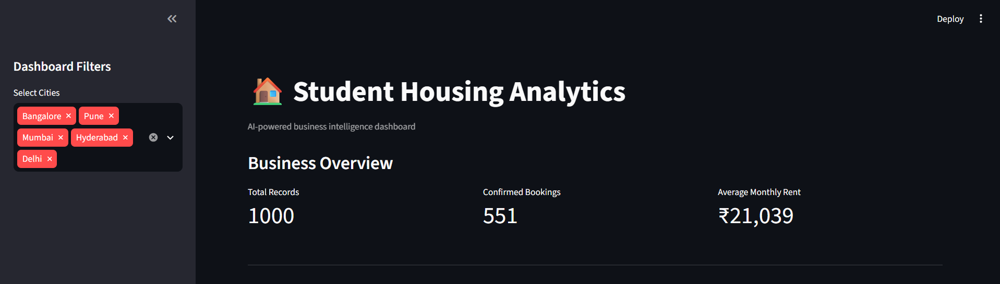
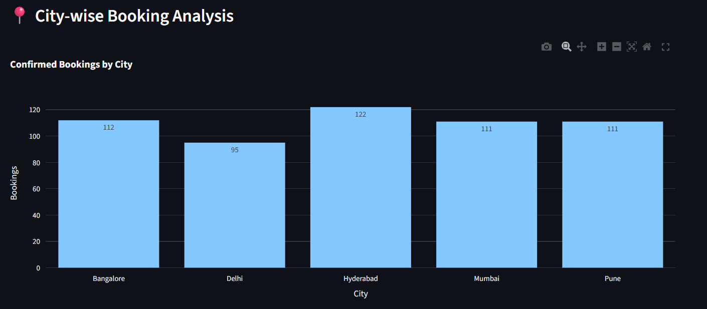
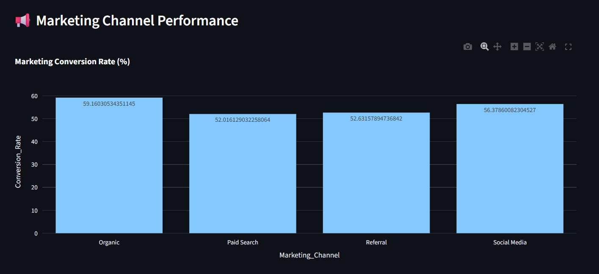
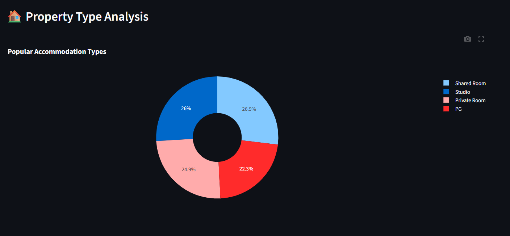
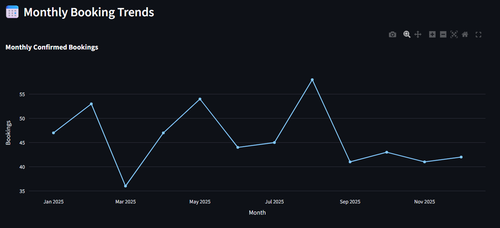
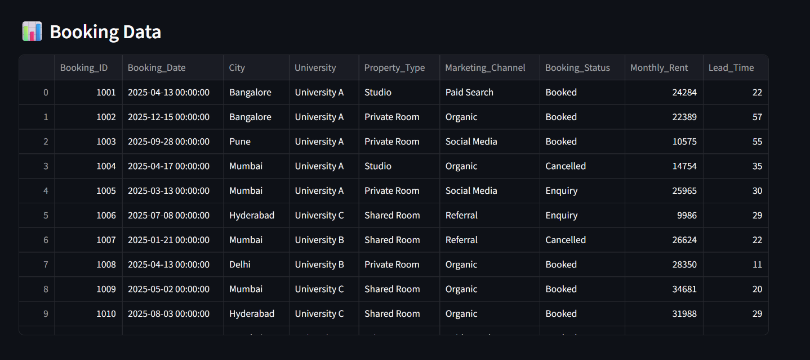
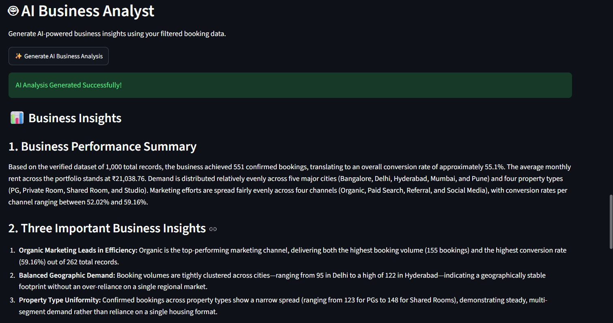
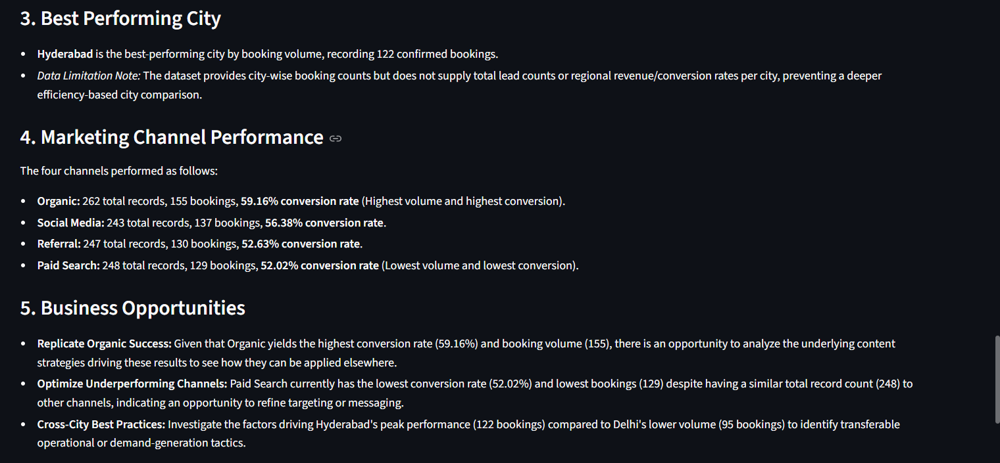
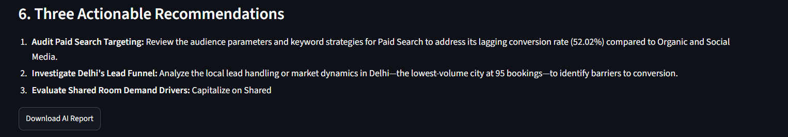

# 🏠 AI-Powered Student Housing Booking Analytics

An interactive business intelligence dashboard that combines **Python, SQL, Streamlit, and Google Gemini AI** to analyse student accommodation booking data and generate actionable business insights.


---

## 📌 Project Overview

This project demonstrates how data analytics and generative AI can help a student accommodation platform understand booking patterns, marketing performance, customer preferences, and potential business opportunities.

Using a synthetic dataset of **1,000 booking records**, the project transforms raw booking data into meaningful business insights through an interactive dashboard and AI-powered analysis.

## 🎯 Business Objectives

* Analyse booking performance across different cities.
* Identify high-performing marketing channels.
* Understand customer accommodation preferences.
* Track monthly booking trends.
* Evaluate average monthly rental prices.
* Generate actionable business recommendations using Generative AI.
* Validate AI-generated insights against actual dataset metrics.

## 🛠️ Technologies Used

| Technology        | Purpose                              |
| ----------------- | ------------------------------------ |
| Python            | Data processing and analysis         |
| Pandas            | Data manipulation and transformation |
| SQL               | Business queries and aggregations    |
| SQLite            | Database management                  |
| Streamlit         | Interactive analytics dashboard      |
| Plotly            | Interactive data visualisation       |
| Google Gemini API | AI-generated business insights       |
| Git & GitHub      | Version control and project hosting  |

## 📊 Dashboard Features

* **Business KPIs:** Total records, confirmed bookings, and average monthly rent.
* **City-wise Analysis:** Compare confirmed bookings across cities.
* **Marketing Performance:** Analyse booking volumes and record-to-booking rates by marketing channel.
* **Property Analysis:** Identify popular accommodation types.
* **Monthly Trends:** Visualise booking patterns over time.
* **Interactive Filters:** Filter dashboard results by city.
* **AI Business Analyst:** Generate business insights and recommendations using Google Gemini AI.

## 🤖 AI Integration – Google Gemini

Integrated Google Gemini API to analyse verified business metrics and generate structured business reports.

The AI Business Analyst provides:

* Business performance summaries.
* Key business insights.
* City-wise performance analysis.
* Marketing channel comparisons.
* Business growth opportunities.
* Actionable recommendations.

**AI Output Validation:**

AI-generated findings are checked against the underlying dataset and SQL results to identify unsupported claims, incorrect calculations, and misleading recommendations.

For example, marketing booking volume and booking rate are evaluated separately to avoid confusing the highest-performing channel by volume with the highest-performing channel by rate.

## 📁 Project Structure

```text
AI-Student-Housing-Analytics/
│
├── app.py
├── analysis.py
├── ai_insights.py
├── generate_data.py
├── test_ai.py
├── bookings.csv
├── requirements.txt
├── .gitignore
├── README.md
│
├── sql/
│   └── queries.sql
│
└── screenshots/
    ├── dashboard-overview.png
    ├── city-booking-analysis.png
    ├── marketing-performance.png
    ├── property-analysis.png
    ├── monthly-booking-trends.png
    ├── booking-data-preview.png
    ├── gemini-ai-insights-1.png
    ├── gemini-ai-insights-2.png
    └── gemini-ai-insights-3.png
```

## ⚙️ Installation and Setup

### 1. Clone the repository

```bash
git clone https://github.com/sahilpandey12/AI-Student-Housing-Analytics.git
```

### 2. Navigate to the project directory

```bash
cd AI-Student-Housing-Analytics
```

### 3. Create a virtual environment

```bash
python -m venv venv
```

### 4. Activate the virtual environment

**Windows:**

```powershell
venv\Scripts\activate
```

### 5. Install dependencies

```bash
pip install -r requirements.txt
```

### 6. Configure Google Gemini API

Create a `.env` file in the project directory.

Add your Gemini API key:

```env
GEMINI_API_KEY=your_api_key_here
```

**Important:** Never upload your `.env` file or API key to GitHub.

### 7. Run the dashboard

```bash
streamlit run app.py
```

The dashboard will open in your default browser.

## 📈 Data Analysis

The project explores the following business metrics:

* Total booking records.
* Confirmed bookings.
* City-wise booking distribution.
* Marketing channel performance.
* Record-to-booking rates.
* Average monthly rent.
* Property type preferences.
* Monthly booking trends.

**Metric limitation:** Marketing booking rates use all records for a channel as the denominator. They are record-to-booking rate proxies, not verified unique-customer lead conversion rates.

## 📸 Project Screenshots

### 1. Dashboard Overview



### 2. City-wise Booking Analysis



### 3. Marketing Channel Performance



### 4. Property Type Analysis



### 5. Monthly Booking Trends



### 6. Booking Data Preview



### 7. Gemini AI Business Insights

**Part 1**



**Part 2**



**Part 3**



## ⚠️ Data Disclaimer

This project uses a synthetic dataset of 1,000 records generated for educational and portfolio purposes.

It does not contain actual Amber customer, booking, or financial data. All business insights and recommendations are illustrative and should not be interpreted as actual company performance.

## 👨‍💻 Author

**Sahil Pandey**

Data Analytics | Python | SQL | Business Intelligence | Generative AI

**GitHub Repository:**
https://github.com/sahilpandey12/AI-Student-Housing-Analytics

---

*Developed as a hands-on data analytics portfolio project to demonstrate practical skills in data analysis, SQL querying, dashboard development, AI integration, and business insight generation.*
